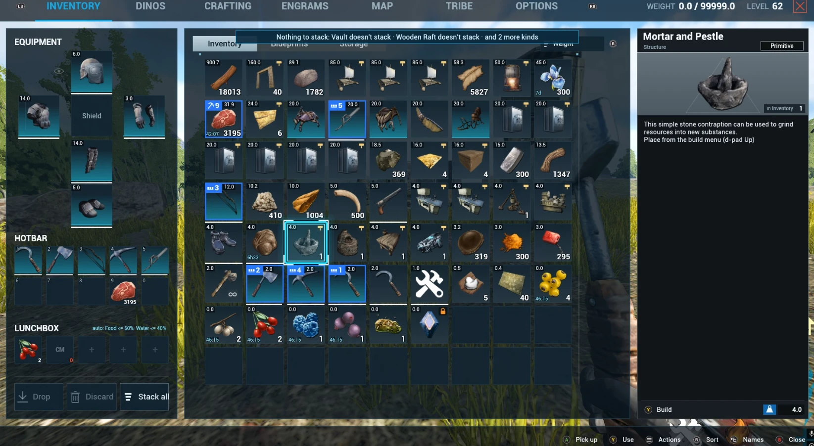
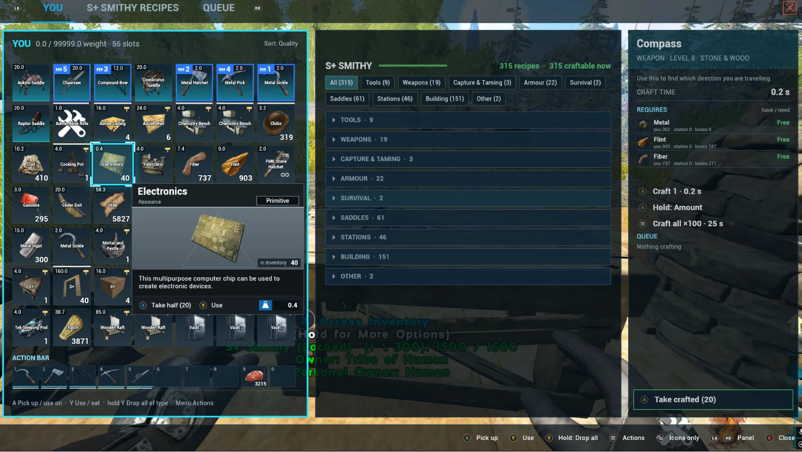
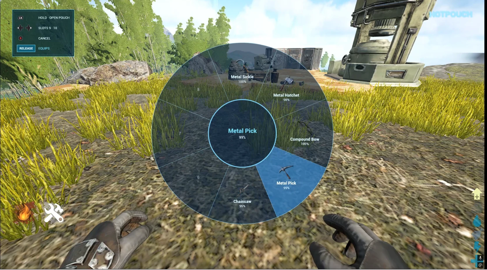
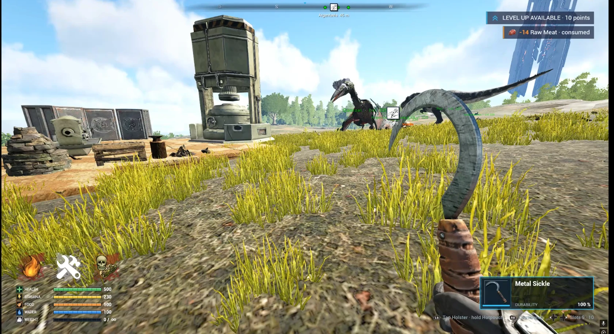
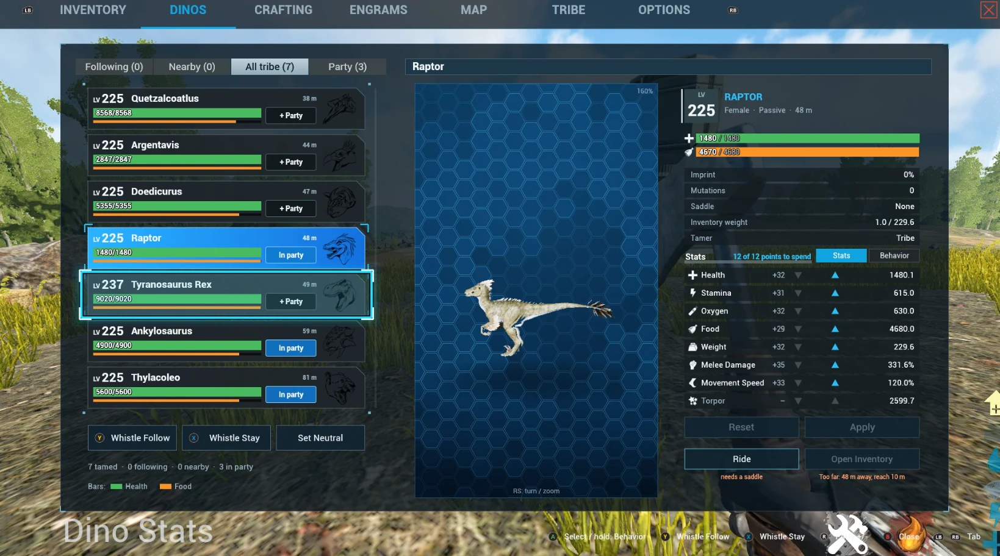
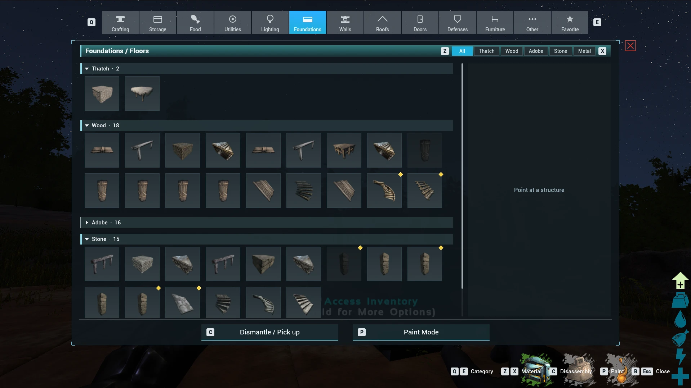
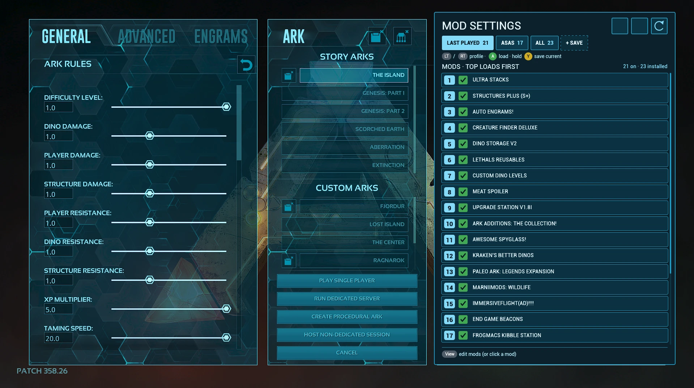

# UI+ (controller only)

A controller-first UI overhaul for **ARK: Survival Evolved** (PC, Steam).

UI+ replaces ARK's inventory, crafting, station, container and map screens with gamepad-friendly ones. It adds radial wheels (Hotpouch, Command Wheel, interaction wheel), a HUD band with buffs, a dino band and toasts, and a gamepad layout built for playing on a controller. Mouse and keyboard still work in all of its screens.

It also replaces ARK's mod list screen with a usable one: drag-and-drop load order, checkboxes to enable/disable mods.

It changes no gameplay by default: crafting times, yields and AI are vanilla. Optional tweaks can be switched on in `arkfix.toml`.

**The only official download is this GitHub page.** Copies anywhere else are unofficial.

## Screenshots
| | |
|---|---|
|  |  |
| Inventory | Crafting at a station |
|  |  |
| Hotpouch wheel | HUD |
|  |  |
| Dino list and stats | Build menu |

*Mod list: load order, profiles, enable/disable*

Screenshots come from a dev build with other mods installed (S+, Ultra Stacks and others), so a few panels and items differ from the release.

## Requirements
- **ARK: Survival Evolved, pre-Aquatica Steam build only** (version.txt 358.25, ShooterGame.exe dated 2025-12-08). On any other build the mod switches itself off and ARK runs vanilla.
- **Single player, or non-BattlEye sessions only.** Launch ARK with BattlEye OFF. Never use it on official or BattlEye servers.

## Install
1. Close ARK.
2. Download the latest `ui-plus-x.y.z.zip` from [Releases](../../releases) and extract `dxgi.dll` and `arkfix.toml` into `<Steam library>\steamapps\common\ARK\ShooterGame\Binaries\Win64` (the folder with ShooterGame.exe and ShooterGame.pdb; the mod needs the .pdb).
3. Start ARK without BattlEye.

**Only want the mod list?** Download `ui-plus-modmenu-only-x.y.z.zip` instead. It's the same `dxgi.dll` with a settings file that turns everything off except the mod list screen; the rest of ARK's UI and controls stay vanilla. Install only one of the two packages.

## Uninstall
Delete `dxgi.dll` and `arkfix.toml` from that folder. Nothing else is changed.

## Notes
- No ARK files are shipped or modified: icons, fonts and pictures are read from your own ARK install while the game runs.
- If another tool also uses a `dxgi.dll` (ReShade, some overlays), the two will clash.
- Use at your own risk. Not affiliated with Studio Wildcard.
- UI+ won't show up in ARK's in-game mod list: it's a DLL, not a Workshop mod.
- Font: Rajdhani (SIL Open Font License, included).

## Is it safe?
The source isn't public, so here is what you can check yourself:
- **What it does:** it loads with ARK, draws its own menus over the game and reads/writes ARK's in-memory UI state. It only writes its own files next to `dxgi.dll`: `arkfix.toml`, `ShooterGame_dxgi.log` and a few `arkfix_*` files (favorites, map markers).
- **What it doesn't do:** it doesn't connect to the internet (the DLL imports no networking libraries), doesn't touch files outside the ARK folder, and doesn't change ARK's files. To uninstall, delete `dxgi.dll` and `arkfix.toml` (and any `arkfix_*` files).
- **Check the file:** compare the SHA-256 of your `dxgi.dll` with the one listed below and in the release notes (PowerShell: `Get-FileHash dxgi.dll`). Only download it from this page.
- You can also upload `dxgi.dll` to [VirusTotal](https://www.virustotal.com) yourself.

| Version | dxgi.dll SHA-256 | Scan |
|---|---|---|
| 0.1.2 | `d64ab5b352a808f71ef5c2470c3b4ab16d1df8c482e376f4493c2458b81185ff` | pending |
| 0.1.1 | `f0531f7e92419f93195aaefa86ffab62503ecd13513529654ba1d9d1f788fb55` | [VirusTotal](https://www.virustotal.com/gui/file/f0531f7e92419f93195aaefa86ffab62503ecd13513529654ba1d9d1f788fb55) |

## Bugs and requests
Open an [issue](../../issues). Include your ARK version, what you pressed, and `ShooterGame_dxgi.log` from `ShooterGame\Binaries\Win64` if you have it. See the [changelog](CHANGELOG.md) for what changed.

## License
Free to use; all rights reserved. No re-uploading, redistributing, selling or modifying without permission. Videos and streams are fine with credit. See [LICENSE](LICENSE).
